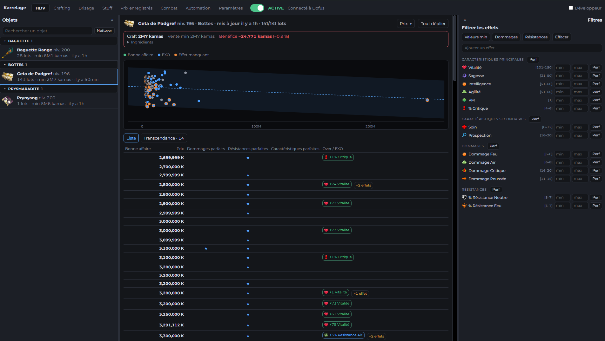

# Karrelage – aide passive pour Dofus Unity

Karrelage-unity, successeur de [Karrelage](https://github.com/JustNao/karrelage), est un outil passif d'aide pour Dofus 3.0 (Unity). Il sniff tous les paquets échangés entre le client et le serveur pour afficher toute sorte d'informations.

Le fonctionnement est strictement passif, sans injection ni automatisation client. Tout se fait par écoute du réseau. Les données restent sur votre ordinateur ; les seules
connexions sortantes servent aux mises à jour (GitHub) et à Dofusbook (import de stuffs, icônes).

PSA: Karrelage est développé sur un serveur monocompte, le comportement en multi-compte peut être imprévisible.

PSA 2: projet codé par IA.



---

# Pour les utilisateurs

## À installer

1. **Karrelage** – téléchargez `Karrelage_x.y.z_x64-setup.exe` depuis les [releases GitHub](https://github.com/JustNao/karrelage-unity/releases)
   et lancez-le.
2. **[Npcap](https://npcap.com)** – le pilote de capture réseau qu'utilise Karrelage pour écouter le trafic du jeu. Installez-le avec les
   options par défaut. Karrelage démarre sans lui, mais la capture reste indisponible (un bandeau vous le signale).

Windows uniquement (10/11, 64 bits).

## Utilisation

1. Lancez Karrelage et activez l'**interrupteur de capture** dans la barre du haut. Il affiche _En attente de Dofus.exe…_ tant que le jeu
   ne tourne pas, puis _Connecté à Dofus_. L'état de l'interrupteur est retenu d'une session à l'autre : vous pouvez laisser Karrelage ouvert en permanence.
2. En jeu, ouvrez des objets à l'**hôtel des ventes** : chaque liste ouverte apparaît dans l'onglet **HDV**. Connectez-vous avec votre
   personnage pendant que la capture tourne pour que Karrelage lise votre inventaire et vos caractéristiques.

| Onglet                           | Rôle                                                                                                                                                                                                                                                                                                                                                                                                                                                                                                                           |
| -------------------------------- | ------------------------------------------------------------------------------------------------------------------------------------------------------------------------------------------------------------------------------------------------------------------------------------------------------------------------------------------------------------------------------------------------------------------------------------------------------------------------------------------------------------------------------ |
| **HDV**                          | Objets scannés regroupés par type (repliables, avec recherche). Par objet : coût de craft comparé à la vente, graphique prix / densité, tableau des lots (prix, dommages / résistances / caractéristiques parfaits, effets au-dessus du max et EXO), _Bonnes affaires_ (lots bien en dessous de la tendance de prix, point vert), filtres d'effets à droite (valeurs min, jet parfait, par effet ou par section) et _Épingler_ pour comparer n'importe quel lot à un lot épinglé.                                              |
| **HDV › Transcendance**          | Liste les lots non transcendés pour lesquels acheter le lot + la rune puis revendre est rentable (investissement, bénéfice, focus par rune) ; _Enregistrer_ garde des candidats pour plus tard.                                                                                                                                                                                                                                                                                                                                |
| **Crafting**                     | _Runes_ : coût de fabrication des runes (ingrédients achetés, ou fabriqués quand c'est moins cher) comparé à leur prix de vente. _Familiers_ : coût en nourriture pour monter un familier d'un niveau à un autre. _Montures_ : rentabilité de l'extraction des dragodindes, muldos et volkornes (ressources obtenues selon la génération, montures séniles signalées).                                                                                                                                                         |
| **Brisage**                      | Rentabilité du brisage des équipements en runes de forgemagie : coefficient à partir duquel briser chaque objet est rentable (craft ou lots scannés), focus, filtres par type / niveau / objets absents de l'HDV. Les coefficients sont lus lors de vos brisages en jeu (ou saisis à la main) et chaque brisage est historisé.                                                                                                                                                                                                 |
| **Stuff**                        | Importe un stuff Dofusbook (lien, identifiant ou lien court) et calcule ses caractéristiques. Prix du stuff (craft, premier jet, lots choisis), recherche de la combinaison de lots la moins chère qui atteint vos objectifs (PA, PM, PdV…, forgemagie comprise), objets déjà possédés (votre exemplaire ou un jet parfait), liste flottante des objets à scanner. _Exporter mon équipement vers Dofusbook_ donne un lien Dofusbook de ce que porte votre personnage (objets, exos, points de caractéristiques et parchemins). |
| **Prix enregistrés**             | Prix unitaire de chaque objet ouvert à l'HDV, par catégorie › type › objet, avec un prix manuel possible. Priorité : votre prix manuel, puis le prix lu à l'HDV, puis la moyenne sur 7 jours envoyée par le jeu.                                                                                                                                                                                                                                                                                                               |
| **Combat**                       | Les monstres du combat en cours avec les notes de stratégie (⚠ danger, 🛡 invulnérabilité, 💡 astuces), leurs particularités (pousse, attire, retraits PA / PM, invocations…) et les interactions dangereuses entre eux ; alerte de poison PA / PM sur votre personnage. Peut s'ouvrir tout seul au début d'un combat et s'afficher dans une petite fenêtre flottante par-dessus le jeu.                                                                                                                                       |
| **Automation**                   | Différentes règles d'automatisation (principalement des sons).                                                                                                                                                                                                                                                                                                                                                                                                                                                                 |
| **Paramètres**                   | Réglages par onglet (seuil des bonnes affaires de l'HDV, options du combat…).                                                                                                                                                                                                                                                                                                                                                                                                                                                  |
| **Paquets** _(mode développeur)_ | Inspecteur de paquets : les derniers paquets de chaque type, décodés à l'ouverture de l'onglet.                                                                                                                                                                                                                                                                                                                                                                                                                                |
| **Proto** _(mode développeur)_   | Vérifie que le pack de données correspond au jeu installé et relance la génération des noms (voir plus bas).                                                                                                                                                                                                                                                                                                                                                                                                                   |

Le mode développeur s'active avec la case _Développeur_ en haut à droite.

## Bon à savoir

- Les données sont stockées dans `%APPDATA%\fr.dofus.karrelage\` (objets scannés, prix, stuffs, inventaire, brisages, packs téléchargés).
  Supprimez le dossier pour tout remettre à zéro.

---

# Pour les développeurs

Deux parties : l'**application Tauri** (ce que lancent les utilisateurs) et un **pipeline Python** (pour les devs) qui transforme les fichiers
du jeu en un petit _pack de données_ (`datapack/`) chargé par l'application. Les conventions détaillées, les notes sur le protocole et le
fonctionnement de chaque onglet sont dans [CLAUDE.md](CLAUDE.md).

## Organisation du dépôt

```
crates/core      wire.rs (varint, trames, enveloppe), stream.rs (réordonnancement TCP), pcap.rs (wpcap.dll chargée à l'exécution),
                 capture.rs (sockets de Dofus.exe + threads d'écoute, filtre BPF limité aux connexions du jeu)
crates/proto     décodage protobuf dynamique depuis datapack/protocol.desc, noms en clair des messages / champs
crates/data      chargement du pack : objets, effets, types d'objets, panoplies, recettes, monstres, textes, bindings
crates/modules   trait Module + Hub, kit.rs (rôles des bindings, stockage persistant, arguments, outils de test) ;
                 un fichier par fonctionnalité : packets, names (Proto), auction (HDV), prices, brisage, stuff, inventory, combat, update
app/             coque Tauri (src-tauri) + interface Svelte 5 / Vite : src/modules/<id>/ = onglets enregistrés automatiquement,
                 src/lib = composants et magasins partagés ; fenêtres flottantes : scanlist.html, combat.html
pipeline/        fichiers du jeu -> pack de données (python)
fixtures/        paquet HDV synthétique + sortie attendue (test de référence)
dist/            datapack.zip + pack.json publiés (versionnés : c'est ce que téléchargent les applications)
datapack/        généré (ignoré par git)      work/   généré, sauf work/overrides.json (noms confirmés à la main – à garder !)
tools/           outils tiers téléchargés (ignorés par git)
```

## Prérequis

| Pour          | Il faut                                                                                                                                        |
| ------------- | ---------------------------------------------------------------------------------------------------------------------------------------------- |
| L'application | Rust (stable, toolchain MSVC), Node 20+, [prérequis de Tauri 2](https://tauri.app/start/prerequisites/) (WebView2, outils de compilation MSVC) |
| La capture    | [Npcap](https://npcap.com)                                                                                                                     |
| Le pipeline   | Python 3.12+, les outils ci-dessous                                                                                                            |

## Après une mise à jour de Dofus

Le plus simple : en mode développeur, l'onglet **Proto** compare le pack au jeu installé et propose _Tout régénérer depuis le jeu_
(`python pipeline/update_names.py --from-game` : copie des fichiers, extraction, protos, données du jeu, noms, pack), _Calculer les noms_
(noms seulement) et _Repack data_ (`--repack` : export + paquetage seulement). Redémarrez ensuite. `update_names.py` termine en committant
`dist/` (_Data pack for Dofus x.y.z.w_) sans le pousser.

À la main, depuis la racine du dépôt dans Git Bash (Windows : `export PYTHONUTF8=1`) :

```bash
# copie (sans jamais les modifier) GameAssembly.dll + global-metadata.dat dans work/dump_input/, extraction avec Il2CppInspectorRedux,
# puis DummyDlls -> protos avec protodec : voir from_game() dans update_names.py pour les commandes exactes
python pipeline/build_protos.py             # compile les protos, écrit work/pb/protocol.desc
python pipeline/extract_gamedata.py --refresh   # copie les données et traductions du jeu dans work/gamedata, les lit avec UnityPy
python pipeline/script_names.py             # noms en clair laissés par la table des scripts Unity -> work/script_names.json
python pipeline/match_protos.py             # correspondance structurelle avec la bêta, ancrée sur ces noms -> work/mapping.json
python pipeline/import_reference_names.py <liste.txt>   # facultatif : liste communautaire obfusqué -> clair
python pipeline/export_pack.py              # -> datapack/
python pipeline/package_pack.py             # -> dist/datapack.zip + dist/pack.json
python pipeline/make_fixtures.py            # seulement si le paquet de démo / le formateur a changé
```

Les noms obfusqués (messages `jzs`, champs `fycg`…) et les numéros de champs changent à chaque version. Priorité des noms :
correspondance automatique avec la bêta < `pipeline/reference/message_names.json` < table des scripts < ancres (`match_protos.py` `ANCHORS` :
messages retrouvés à chaque version par leur voisin et la longueur de leur nom) < `work/overrides.json` (indexé par les noms obfusqués, donc
à revoir après chaque mise à jour). `pipeline/bindings.json` associe des _rôles_ (champs des listes HDV, des effets, de l'inventaire…) aux noms
de champs obfusqués : il faut en général le mettre à jour, et l'onglet **Proto** signale les rôles qui ne se résolvent plus. Le code de
l'application ne contient jamais de nom obfusqué en dur.

Alternative en ligne de commande pour enregistrer des paquets : `python pipeline/sniff.py` (ajoutez `--raw` pour l'hexadécimal du contenu) écrit du JSONL.

## Lancer, tester, construire l'application

```bash
cargo test                      # tests unitaires + test de référence (sortie Rust == sortie du formateur python ; ignorés sans datapack/)
cd app && npm install
npm run tauri dev               # application de développement (cochez « Développeur » pour les onglets Paquets et Proto)
npm run check                   # svelte-check
npm run tauri build             # installeur NSIS dans target/release/bundle/nsis/, inclut datapack/ comme ressource
```

L'installeur nécessite d'avoir généré `datapack/` auparavant (ou de l'avoir décompressé depuis `dist/datapack.zip`).
